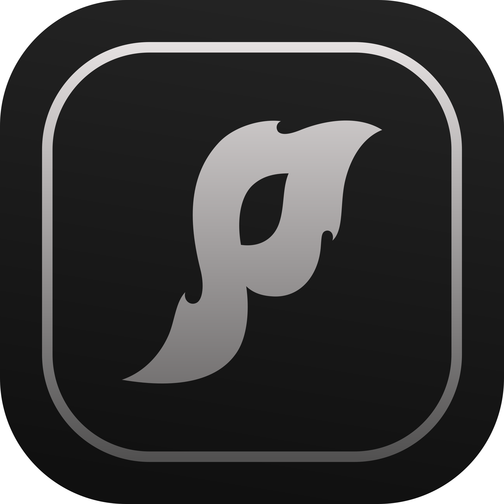

# Powerhouse

<p align="center">
  
</p>

<h1 align="center">Powerhouse</h1>

<p align="center">
  My OpenCode harness: configuration, plugins, MCP servers, skills, and tools.<br>
  One clone, one install script, the same agent on every machine.
</p>

<p align="center">
  <a href="LICENSE"></a>
  
  
  
</p>

---

Powerhouse is the portable copy of my OpenCode setup. It carries the server
configuration, the plugins and MCP servers I run, the skills I wrote or adapted,
and the small tools that make the agent useful outside the terminal. Install it
on Windows, macOS, or Linux and OpenCode behaves the same way it does on my
machine.

## Quick start

```bash
git clone https://github.com/bitm4ncer/Powerhouse.git
cd Powerhouse
bash install.sh
```

```powershell
git clone https://github.com/bitm4ncer/Powerhouse.git
cd Powerhouse
powershell -NoProfile -ExecutionPolicy Bypass -File install.ps1
```

The installer:

1. backs up every file it will overwrite to `~/.config/opencode/backup-<timestamp>/`
2. renders `config/opencode.json.tpl` into `~/.config/opencode/opencode.json`
3. copies `opencode-mem.jsonc`, `dcp.jsonc`, and all skills into the config directory
4. runs `npm ci` in `clipy-mcp/`

Options: `--skip-install` (bash), `-SkipInstall` and `-CfgDir <path>` (PowerShell).

### Requirements

- OpenCode 2.x
- Node.js 20+ with npm
- git
- Optional: `craft-anything-cli` for the Craft Anything MCP server

### After installing

- Sign in to your model provider in OpenCode (`/connect`).
- Optional: `npx -y @clipy/cli@latest login` for Clipy.
- Optional: authenticate MCP servers through `/mcps`.
- Optional: create your own memory export (see [memory/README.md](memory/README.md)).

## What is inside

| Path | What it is |
| --- | --- |
| `config/opencode.json.tpl` | OpenCode config template: plugins, providers, MCP servers |
| `config/opencode-mem.jsonc` | opencode-mem plugin configuration |
| `config/dcp.jsonc` | Dynamic Context Pruning configuration |
| `skills/` | 9 skills (see below) |
| `tools/dictate/` | Windows push-to-talk dictation (Whisper + a mouse button) |
| `scripts/` | setup, snapshot, verify, and the config renderer |
| `clipy-mcp/` | pinned `@clipy/mcp` package manifests |
| `memory/` | empty by design; holds your own export |

### Plugins

| Plugin | Purpose |
| --- | --- |
| `superpowers@git+https://github.com/obra/superpowers.git` | Skills framework and methodology: brainstorming, TDD, planning, code review |
| `videowizard@git+https://github.com/bitm4ncer/VideoWizard.git` | Video planning and production suite |
| `@plannotator/opencode@latest` | Interactive plan review with visual annotation |
| `opencode-mem@latest` | Persistent local memory with a vector store and a web UI |
| `@tarquinen/opencode-dcp@latest` | Dynamic Context Pruning before context limits are hit |
| `opencode-scheduler` | Scheduled non-interactive OpenCode jobs through the OS scheduler |

### MCP servers

| Server | Type | Purpose |
| --- | --- | --- |
| `context7` | remote | Up-to-date library documentation |
| `videowizard` | local | VideoWizard project tooling |
| `excalidraw` | local | Live Excalidraw canvas |
| `clipy` | local | Clipy screen recordings as agent context |
| `craft-anything` | local | Study and rebuild websites, apps, and games (Craft Anything) |
| `rea` | local | Reverse engineering (native, managed, browser) |
| `figma` | local | Figma bridge over a WebSocket |
| `blender` | local | Blender control through `blender-mcp` |
| `diffusion` | remote, local | Diffusion Studio integration |

Servers such as Blender, Figma, Strata, and VideoWizard need their own
application installed. The harness only configures the connection. Craft
Anything is a separate Rust binary: install `craft-anything-cli` and put it on
`PATH`, or set `CRAFT_ANYTHING_CLI` to its absolute path.

### Skills

| Skill | What it does | Upstream license |
| --- | --- | --- |
| `brag` | Short launch videos from a project, with music and motion | Apache-2.0 (Hyperframes); assets CC BY / CC0 |
| `craft-anything` | Study and rebuild websites, apps, and games | original skill; engine MIT / Apache-2.0 |
| `effect-house` | TikTok Effect House project editing | original |
| `excalidraw-skill` | Excalidraw canvas toolkit | MIT (`yctimlin/mcp_excalidraw`) |
| `gumroad` | Gumroad data and store management from the terminal | original |
| `magpie-manager` | Magpie/Kirby panel editing | original |
| `reverse-engineer-anything` | REA reverse-engineering workflows | MIT (`morluto/rea`) |
| `rip` | DVD to Jellyfin pipeline | original |
| `seo-autofill` | SEO, meta tags, and JSON-LD for Magpie sites | original |

Two skills are **not bundled** because their upstream licenses do not allow
redistribution:

- `frontend-design` (Anthropic) — install it from its upstream source.
- `watch-clipy-recording` (Clipy) — install it from Clipy.

## Configuration

The template uses placeholders that the installer fills in:

| Placeholder | Value |
| --- | --- |
| `{{HOME}}` | your home directory |
| `{{TMP}}` | the system temp directory |
| `{{CLIPY_MCP_ENTRY}}` | `clipy-mcp/node_modules/@clipy/mcp/dist/index.js` |
| `{{VIDEOWIZARD_DIR}}` | `$VIDEOWIZARD_DIR` or `~/VideoWizard` |
| `{{FIGMA_SERVER}}` | `$FIGMA_SERVER` or `~/tools/cursor-talk-to-figma-mcp/dist/server.js` |
| `{{CRAFT_ANYTHING_CLI}}` | `$CRAFT_ANYTHING_CLI` or `craft-anything-cli` on `PATH` |

`OPENCODE_CFG_DIR` overrides the config directory on bash. The template also
configures a local **Strata** provider for Qwen3.8-Flash-Next; remove the
`providers.strata` block if you do not run Strata.

## Memory

Powerhouse ships **no memories**. `memory/` is a placeholder, and
`memory/export.json` plus `memory/global-rules.json` are git-ignored. Export
your own memory with the opencode-mem tool; see
[memory/README.md](memory/README.md). The snapshot scripts remind you when the
export is missing or older than seven days.

## Tools

### dictate

Windows push-to-talk dictation: hold a mouse thumb button, speak, and the text
is inserted into the focused window. It uses Whisper `large-v3-turbo` with CUDA
and a CPU fallback, keeps a vocabulary and a replacement list, and runs from the
system tray. Install the Python requirements from `tools/dictate/` and start
`dictate.py`.

## Scripts

| Script | Purpose |
| --- | --- |
| `setup.ps1` / `setup.sh` | install the harness into the OpenCode config directory |
| `snapshot.ps1` / `snapshot.sh` | copy the live config back into the template, with a secret guard |
| `verify.ps1` / `verify.sh` | check that the installation is complete |
| `render-config.js` | dependency-free, JSON-safe template renderer |

## What is not in this repository

- credentials, API keys, `service.json`, auth tokens
- the session database and chat history
- caches, logs, and recordings
- personal memories

## Credits

See [THIRD_PARTY.md](THIRD_PARTY.md). Music: Sascha Ende, CC BY 4.0. SFX:
Kenney, CC0.

## License

MIT for the original code and configuration. Third-party skills and assets keep
their own licenses; see [THIRD_PARTY.md](THIRD_PARTY.md).
